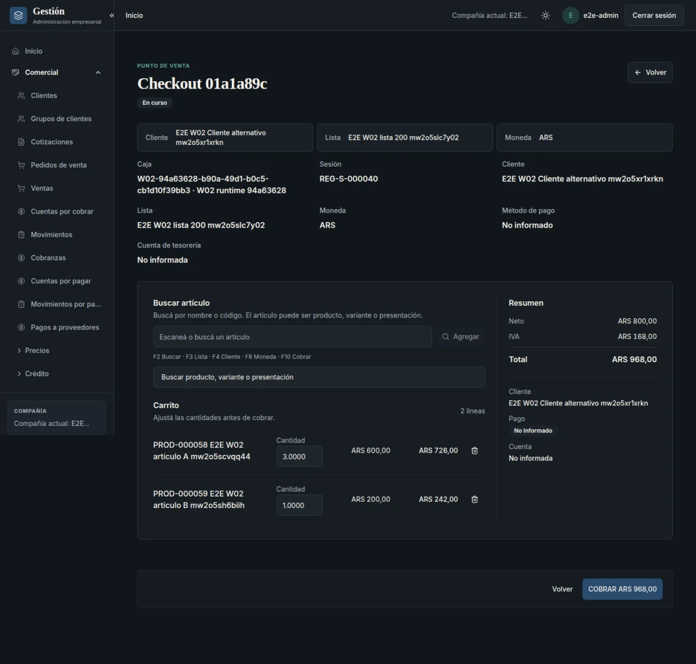

Gestión es un producto empresarial modular y reutilizable que desarrollo para conectar procesos comerciales, inventario, logística, facturación y finanzas. El desafío no es solamente ofrecer pantallas para cargar datos: es conseguir que una operación conserve su significado cuando intervienen varios dominios, aparecen reintentos o cambian los datos maestros.

Una venta, una entrega, una factura, una deuda y un cobro están relacionados, pero no son el mismo hecho. Modelarlos como si fueran una única operación vuelve difíciles las entregas parciales, las anulaciones y la recuperación ante errores. Esa separación es el punto de partida del proyecto.

> Este caso presenta decisiones de ingeniería y capacidades revisadas a noviembre de 2026. El repositorio es privado: no se publica código interno ni documentación confidencial. Gestión y [Granalia](/blog/granalia-sistema-facturacion/) son proyectos diferentes; las experiencias productivas de Granalia no acreditan el estado de Gestión.

## Objetivos del producto

El objetivo es mantener una base común que pueda adaptarse a distintas operaciones empresariales sin crear una versión de código por cliente. Las diferencias se expresan mediante datos maestros, configuración, perfiles de módulos y adaptadores.

Esto plantea tres necesidades técnicas:

- **Componer capacidades sin romper dependencias.** Activar un módulo exige que estén disponibles los contratos y mecanismos que necesita.
- **Preservar los hechos históricos.** Cambiar un precio o un cliente no debe reinterpretar un documento confirmado.
- **Hacer explícitos los límites operativos.** Una capacidad implementada no equivale a un circuito homologado, aceptado de extremo a extremo o habilitado para producción.

El modelo previsto es una instalación aislada por cliente, con sus datos, secretos, archivos y respaldos. No se plantea una base compartida entre clientes no relacionados. Los perfiles y la composición existen; eso no implica que todos los perfiles comerciales finales ni sus despliegues estén validados.

## Arquitectura general

El backend está organizado como un **monolito modular** con FastAPI y PostgreSQL. Los dominios forman parte de una misma aplicación, pero tienen responsabilidades y contratos de colaboración definidos. La modularidad no depende de repartir el sistema en microservicios.

Esta decisión permite coordinar operaciones locales con transacciones de base de datos sin introducir de entrada llamadas de red entre todos los dominios. El costo es que los límites deben cuidarse: compartir proceso y base no habilita a cualquier módulo a modificar las tablas de otro.

Distingo cuatro responsabilidades:

- **Núcleo de tipos y reglas transversales:** dinero, cantidades, identificadores y tiempo, sin dependencia del framework HTTP ni del ORM.
- **Plataforma técnica:** idempotencia, numeración, almacenamiento y entrega de eventos.
- **Módulos empresariales:** reglas, datos y contratos de cada dominio.
- **Composición de la aplicación:** selección de módulos, validación de dependencias y conexión de implementaciones concretas.

El frontend React consume una API REST y las capacidades que publica el backend. Así puede adaptar navegación y acciones a la composición habilitada. La autorización sigue estando en el servidor: ocultar una opción no protege una operación.

El diagrama resume responsabilidades, no servicios independientes. Omite el worker y los proveedores externos para concentrarse en la relación entre interfaz, contratos, módulos y persistencia.

## Diseño modular y límites de dominio

La pregunta más útil al diseñar un módulo fue **qué hecho puede afirmar con autoridad**.

Ventas gobierna el compromiso comercial. Inventario gobierna existencias, reservas y movimientos. Logística coordina preparación, remitos y entregas. Facturación conserva documentos económicos, mientras que Fiscal administra la relación con el proveedor de autorización. Cuentas corrientes registra deuda, créditos e imputaciones; Tesorería registra movimientos de fondos.

Esta separación evita efectos implícitos difíciles de revertir. Una factura no descuenta stock por el mero hecho de emitirse. Una entrega no crea deuda automáticamente. Una devolución física no equivale a una nota de crédito. Los flujos que conectan esos hechos deben coordinarse de manera explícita.

Los módulos colaboran mediante contratos públicos, como lectores y puertos de comandos. No deberían resolver una necesidad importando el repositorio concreto o el modelo ORM de otro dominio. El ensamblado de implementaciones queda concentrado en la composición de la aplicación.

La política está acompañada por pruebas de arquitectura y controles de importaciones. No la presento como una separación perfecta: existen excepciones y deuda documentadas. Su valor es convertir una intención de diseño en una restricción que se puede revisar y probar.

## Stack tecnológico y contrato de API

El backend utiliza **Python, FastAPI, Pydantic, SQLAlchemy asíncrono y psycopg**, con **PostgreSQL** para persistencia y **Alembic** para evolución del esquema. Docker permite preparar entornos reproducibles y dependencias aisladas.

La interfaz utiliza **React, TypeScript, Vite y React Router**, junto con TanStack Query para consultas y estado remoto. Los formularios y componentes reutilizables mantienen la interacción separada del acceso a la API.

El contrato **OpenAPI** se exporta desde la aplicación compuesta y alimenta la generación del cliente TypeScript. Los adaptadores del frontend consumen ese cliente, en lugar de distribuir detalles de transporte por todas las pantallas.

La ventaja no es solamente autocompletar tipos: un cambio en el backend tiene una superficie contractual que CI puede contrastar con el esquema y el cliente generado. Esto reduce desajustes accidentales, aunque el tipado no sustituye las pruebas de reglas de negocio ni elimina toda adaptación local del frontend.

## Módulos y funcionalidades implementadas

La revisión del código, contratos y pruebas confirma implementación para estos grupos de procesos, con distintos niveles de validación:

- **Base organizacional:** empresas, locales, usuarios, permisos, clientes y proveedores.
- **Catálogo y precios:** productos, variantes, presentaciones, listas, vigencias, reglas, descuentos y edición masiva.
- **Gestión comercial:** acuerdos, cotizaciones, pedidos y ventas con confirmación, cancelación y snapshots.
- **Abastecimiento y stock:** órdenes de compra, recepciones, documentos de proveedor, depósitos, ubicaciones, lotes, reservas, movimientos y conteos.
- **Logística:** preparación, remitos, despacho, entrega, rechazos y devoluciones.
- **Facturación y fiscal:** documentos, numeración, emisión, archivos y solicitudes de autorización fiscal; existe un adaptador ARCA para WSAA y WSFEv1.
- **Finanzas y POS:** cuentas corrientes, cobranzas, pagos a proveedores, imputaciones, antigüedad de saldos, reversas compensatorias, cuentas de tesorería, cajas, sesiones y checkout reanudable.

En POS, el alcance operativo implementado contempla **efectivo y transferencia bancaria**. La existencia de un catálogo extensible de medios de pago no significa que estén integradas tarjetas, billeteras, cheques o pagos divididos.

### Una interfaz sobre hechos del servidor

La captura proviene de un entorno de aceptación aislado con datos exclusivamente ficticios. Muestra un carrito recuperado durante una prueba de POS; no es una operación comercial real ni evidencia de facturación fiscal productiva. Los nombres e identificadores visibles pertenecen a datos de prueba.

El trabajo de interfaz acompaña al modelo: el contexto comercial, los artículos y los totales deben representar el estado que reconoce el backend, no una segunda interpretación del negocio calculada en el navegador.

## Consistencia, idempotencia y seguridad

### Dinero e históricos

Los importes y cantidades se modelan con **Decimal y NUMERIC**, con moneda y criterios de redondeo explícitos. En documentos, importa preservar las líneas y sus totales redondeados: recalcular más adelante desde precios vigentes puede producir un resultado distinto al comprometido originalmente.

Los snapshots conservan el contexto de las operaciones confirmadas. Las correcciones financieras utilizan hechos compensatorios vinculados al original, en lugar de borrar o reescribir silenciosamente el movimiento histórico. Los permisos, las restricciones de base y las transiciones de estado complementan esa protección.

### Reintentar no es volver a empezar

Un timeout no permite saber, por sí solo, si una operación falló. El servidor puede haber confirmado el cobro y perderse solamente la respuesta. Repetir la acción con una identidad nueva puede duplicar efectos.

Por eso la idempotencia se asocia a una intención y su contexto, no solamente a deshabilitar un botón. El backend dispone de mecanismos persistentes de idempotencia y restricciones de unicidad para operaciones críticas. En el trabajo reciente de POS, ciertos comandos conservan su identidad ante una respuesta incierta para poder reintentarlos sin convertirlos en una operación distinta.

La recuperación no es universal: perder por completo el almacenamiento local no está cubierto por la evidencia acotada de esos comandos. Tampoco todos los workflows comparten automáticamente las mismas garantías.

### Transacciones cortas y coordinación durable

El checkout coordina responsabilidades de varios módulos. Mantener una única transacción abierta durante todo el circuito, incluyendo archivos o integraciones, haría más difícil manejar bloqueos y fallos parciales.

La implementación utiliza pasos persistentes, transacciones acotadas e identidades idempotentes por paso. Así puede reanudar una ejecución desde el progreso registrado. La suite incluye un caso especialmente relevante: el cobro ya se confirmó, pero falla la escritura del punto de avance. El reintento debe recuperar ese resultado, no crear otra cobranza.

La outbox permite registrar eventos junto con cambios transaccionales y entregarlos después mediante un worker separado de la API. Una entrega que puede repetirse exige consumidores idempotentes; no equivale a prometer ejecución «exactamente una vez» de todo el sistema.

### Seguridad en varias capas

La base de seguridad incluye sesiones con cookies, protección CSRF, permisos evaluados en backend y controles de acceso por empresa. Las relaciones compuestas en PostgreSQL refuerzan la integridad entre entidades de una misma empresa incluso ante errores de aplicación.

El proceso de migraciones utiliza un rol distinto al del runtime. Esto permite separar los privilegios necesarios para modificar el esquema de los necesarios para operar el producto. La auditoría de acciones críticas y el cuidado de secretos y logs completan el enfoque, sin constituir por sí solos una certificación de seguridad o de aislamiento multiempresa integral.

## Testing, CI y calidad del software

La estrategia combina capas de pruebas que responden preguntas diferentes:

- **Unitarias:** cálculos, reglas, validaciones y transiciones de dominio.
- **Arquitectura y contratos:** dependencias permitidas, superficies públicas y coherencia de OpenAPI.
- **Integración:** PostgreSQL real, migraciones, permisos, restricciones, concurrencia y persistencia; también almacenamiento compatible con S3 en entornos de prueba.
- **Frontend:** Vitest y Testing Library para componentes y comportamiento.
- **E2E:** Playwright contra una pila aislada con backend, base, almacenamiento y worker.

GitHub Actions ejecuta lint, comprobaciones de tipos, tests, builds y controles de sincronización del contrato y del cliente generado. La cobertura Python se combina entre trabajos antes de aplicar el umbral configurado. Un umbral o una meta de cobertura no son una medición del resultado actual, por lo que no presento porcentajes como logro del proyecto.

En la revisión de este artículo, la ejecución de CI correspondiente al commit inspeccionado de `main` figura como exitosa. Es evidencia de los controles de esa ejecución, no una certificación de todos los escenarios de negocio. No ejecuté nuevamente la suite completa de Gestión para preparar esta publicación.

## Desafíos técnicos y decisiones de diseño

### Separar hechos sin fragmentar innecesariamente el sistema

Un mismo flujo de usuario atraviesa varias autoridades de negocio. La solución no fue duplicar ventas, cobros o stock dentro de POS, sino coordinar los contratos de los módulos dueños. Esto hace más explícita la recuperación y evita fuentes de verdad competidoras, a costa de diseñar cuidadosamente las dependencias.

### Coordinar base de datos y archivos

Emitir un documento implica persistencia y almacenamiento fuera de PostgreSQL. No existe una transacción SQL que confirme ambos recursos por arte de magia.

La emisión distingue reserva de número y snapshot, generación del archivo y finalización. Un fallo debe conservar el número asignado para reintentar, y el estado emitido requiere una referencia válida al archivo. Los estados intermedios son parte del modelo de recuperación, no detalles que se puedan ocultar con un mensaje genérico de error.

### Integrar un proveedor fiscal sin confundir implementación con habilitación

La frontera fiscal separa el documento económico de la autorización externa. El adaptador ARCA implementado resuelve comunicación con WSAA y WSFEv1 detrás de un contrato, junto con mecanismos de consulta ante respuestas inciertas.

El límite es importante: **la homologación contra ARCA real y la habilitación productiva no están acreditadas**. También existen restricciones y trabajo pendiente en recuperación fiscal. Las pruebas con un proveedor simulado permiten verificar parte del flujo interno, pero no demuestran interoperabilidad fiscal real.

### Evolucionar sin bifurcar el producto

Los perfiles permiten seleccionar módulos sin eliminar su historia ni mantener forks por cliente. Eso exige validar dependencias y compatibilidad del esquema. Alembic mantiene una cadena de migraciones lineal: el arranque de la aplicación no debe improvisar cambios de estructura.

## Estado actual y evolución prevista

**Implementado y revisado estáticamente:** la base modular, la API y el cliente generado, las superficies frontend y los procesos comerciales, logísticos y financieros descritos. La revisión contrasta documentación vigente con código, configuración y pruebas; no equivale a ejecutar cada circuito.

**Evidencia de ejecución acotada:** además del CI consultado, existe aceptación registrada de un conjunto de comandos POS con backend y PostgreSQL reales, datos sintéticos, recuperación de respuestas perdidas y recorridos en móvil, tablet y escritorio, en temas claro y oscuro. Esa evidencia no cubre el checkout completo ni certifica la aceptación visual de toda la aplicación.

**Pendiente de validación:** aceptación integrada y visual del conjunto de workflows, homologación fiscal y condiciones de habilitación productiva. No presento Gestión como un producto validado en producción ni atribuyo usuarios, métricas o resultados comerciales no demostrados.

**Planificado:** manufactura, costeo industrial, reporting ampliado, operación offline/PWA, perfiles comerciales finales e integraciones bancarias. La conciliación bancaria, pagos divididos y medios de pago integrados tampoco deben inferirse de la infraestructura existente. Las ampliaciones de recuperación financiera tienen diseño aprobado en ciertos alcances, pero eso no las convierte en funcionalidades disponibles.

## Conclusiones y aprendizajes

Gestión reúne trabajo full-stack, pero su parte más exigente está en el backend: definir quién es dueño de cada hecho, preservar sus invariantes y permitir que un proceso avance o se recupere sin duplicar efectos.

El aprendizaje principal es que la mantenibilidad de un sistema empresarial depende tanto de sus límites como de sus funcionalidades. Los contratos ayudan a colaborar entre módulos; las transacciones y restricciones protegen la consistencia; los snapshots preservan el pasado; y las pruebas de fallo obligan a diseñar qué ocurre después de una respuesta perdida.

Construir un producto completo también exige saber qué todavía no está demostrado. Separar implementación, validación y planificación permite comunicar el trabajo con precisión y decidir el próximo paso con evidencia.
