Granalia es una aplicación web desarrollada para digitalizar el circuito operativo de una empresa alimenticia. El sistema reemplaza planillas y tareas manuales por una herramienta centralizada para cargar pedidos, administrar clientes, proveedores, productos, transportes, listas de precios, remitos, comprobantes fiscales, compras, stock, costos, PDFs, historial, estadísticas e integración fiscal con ARCA.

El proyecto combina frontend React, backend FastAPI y PostgreSQL. La decisión principal fue separar la interfaz de la lógica de negocio: el frontend se enfoca en formularios, navegación por rol y experiencia de carga; el backend concentra validaciones, cálculos, persistencia, generación de PDFs e integraciones externas.

## Problema

La operación necesitaba resolver tres problemas principales:

- Reducir errores de carga manual en pedidos, clientes, productos y transportes.
- Mantener un historial confiable aunque cambien precios, productos o datos fiscales.
- Unificar gestión comercial, remitos internos y emisión fiscal legal en un mismo flujo.

Para resolverlo, modelé el sistema alrededor de documentos comerciales, comprobantes fiscales, ítems, clientes, catálogos, listas de precios y lotes de emisión. Cada documento guarda snapshots históricos de los datos relevantes, de modo que una modificación futura en el catálogo no altere operaciones ya emitidas.

## Arquitectura

El backend está organizado con responsabilidades separadas:

- `app/api/routes`: endpoints HTTP.
- `app/domain`: modelos y conceptos de dominio.
- `app/services`: reglas de negocio, PDFs, catálogos y ARCA.
- `app/infrastructure`: persistencia PostgreSQL.
- `app/core`: configuración, seguridad y logging.
- `migrations`: versionado de base con Alembic.

El frontend usa React 18, React Router, Vite, Tailwind CSS y Context API. La aplicación renderiza pantallas protegidas, mantiene estado de sesión, consume la API REST, muestra previews de remitos o comprobantes fiscales y habilita acciones según permisos.

## Casos de uso principales

El sistema cubre el flujo comercial completo:

- Login seguro con roles de administrador y operador.
- Gestión de clientes, productos, transportes y listas de precios.
- Carga de pedidos con descuentos, bonificaciones y notas.
- Generación de remitos internos con numeración propia.
- Emisión fiscal de Factura A integrada con ARCA.
- Notas de crédito asociadas a comprobantes autorizados.
- Gestión de proveedores y compras de materia prima por producto y kilos.
- Control de stock, costos de reposición y costos de envases por formato.
- Historial operativo con filtros, detalles y descarga de PDFs.
- Estadísticas comerciales, rentabilidad, rankings y mapa de presencia restringidos a administradores.

> Los datos visibles en las capturas son ficticios y fueron cargados únicamente para mostrar los casos de uso del sistema.

### Panel de gestión

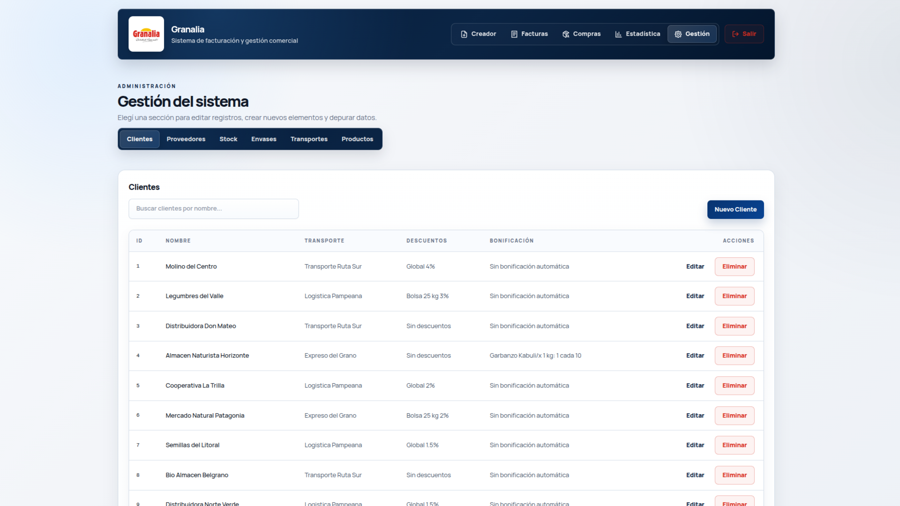

El panel de gestión centraliza los módulos operativos: clientes, proveedores, productos, transportes, listas de precios, compras, stock, costos, remitos, comprobantes fiscales, notas de crédito y estadísticas. La idea fue que el usuario no tenga que moverse entre planillas o herramientas externas para completar el circuito comercial.

El acceso al sistema parte de una pantalla protegida para operadores y administradores. Desde ahí se inicia una sesión con cookie HTTP-only y token CSRF; el rol del usuario determina qué módulos puede ver y qué acciones sensibles puede ejecutar.

### Administración de catálogos

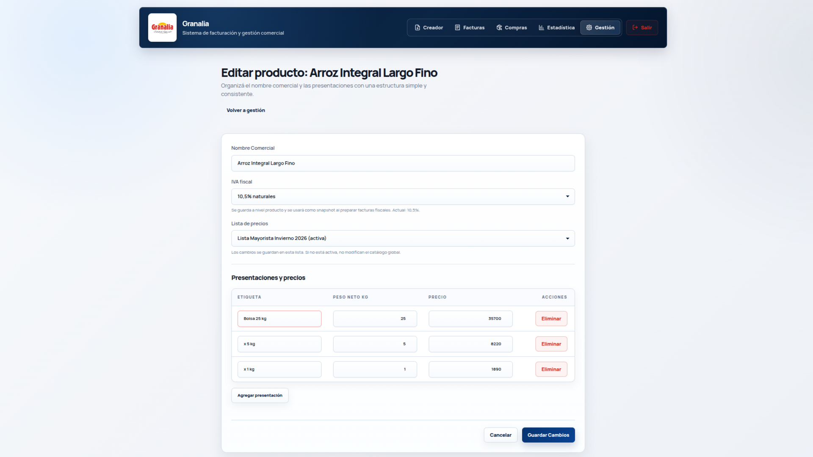

Las pantallas CRUD permiten mantener datos maestros como clientes, proveedores, productos, presentaciones y transportes. Estos datos alimentan la carga de pedidos, compras y comprobantes, y quedan desacoplados de los remitos y comprobantes fiscales ya emitidos mediante snapshots históricos, para evitar que una modificación posterior altere documentos existentes.

En clientes y proveedores se incorporó consulta fiscal por CUIT contra ARCA para precargar razón social y domicilio cuando el servicio está disponible. En productos se agregó configuración de IVA fiscal por producto, con validaciones para evitar nombres duplicados y mantener consistente el catálogo usado por facturación.

### Carga y edición de listas de precios

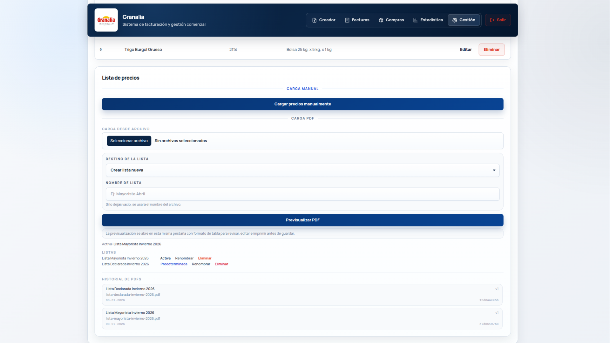

La carga de listas de precios permite subir archivos, revisar el contenido detectado y preparar una versión antes de activarla. Esto reduce errores de transcripción y mantiene trazabilidad sobre qué lista estaba vigente en cada operación.

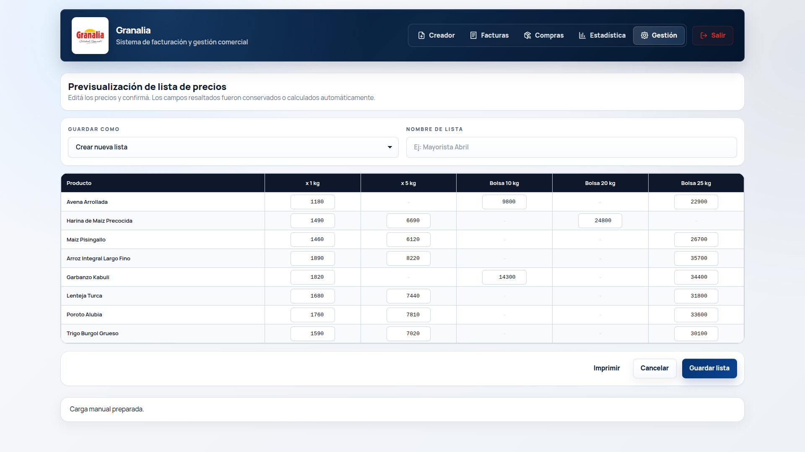

La edición de listas permite corregir precios, presentaciones o datos asociados antes de usar la versión en nuevos pedidos, remitos o comprobantes fiscales. El caso de uso está pensado para que administración pueda validar cambios comerciales sin tocar directamente los documentos históricos.

### Creación de comprobantes

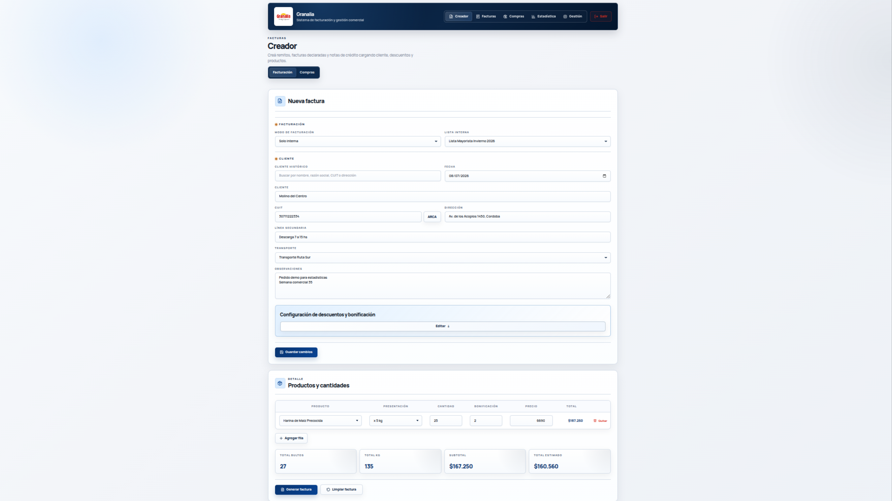

El creador de comprobantes concentra el flujo de pedido: selección de cliente, transporte, productos, cantidades, descuentos, bonificaciones y tipo de documento. Desde esta pantalla se resuelven remitos de gestión y, cuando corresponde, la emisión legal de facturas fiscales contra ARCA.

El flujo soporta tres modos de trabajo: comprobante interno, factura declarada y pedido dividido. En el modo dividido, el usuario carga el pedido una sola vez y el sistema calcula la parte interna y la parte fiscal por cantidades, usando lista interna y lista declarada por separado. Antes de guardar se muestra una vista previa con cantidades, totales sin IVA, totales con IVA y advertencias si falta un producto, una presentación o la alícuota fiscal correspondiente.

También se normaliza el domicilio fiscal cargado desde ARCA para que el PDF y el historial mantengan una lectura consistente. Las operaciones sensibles, como crear comprobantes fiscales o divididos, piden una contraseña adicional antes de persistir el documento.

### Historial y detalle de comprobantes

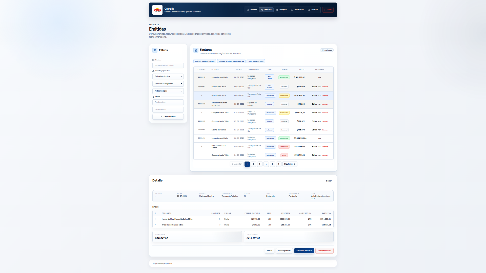

El listado de comprobantes funciona como historial operativo. Permite buscar remitos y documentos fiscales, revisar estados, descargar PDFs y acceder a acciones controladas según reglas de negocio, por ejemplo editar borradores o consultar facturas fiscales ya autorizadas.

El detalle de comprobante muestra la composición completa del documento: cliente, transporte, ítems, totales y, si corresponde, datos fiscales y estado de autorización. Este caso de uso es clave para auditoría operativa, soporte comercial y verificación antes o después de emitir legalmente en ARCA.

### Estadísticas comerciales

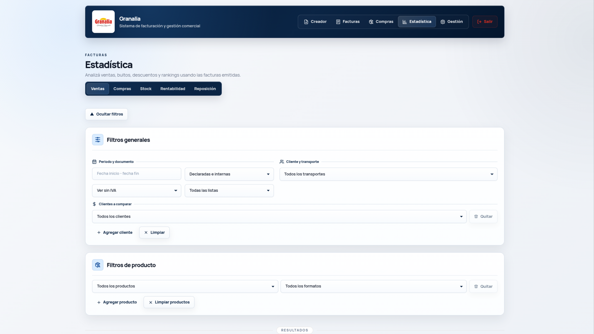

El módulo de estadísticas permite filtrar la información comercial por períodos y criterios operativos. Esta vista está restringida a administradores porque concentra indicadores sensibles del negocio.

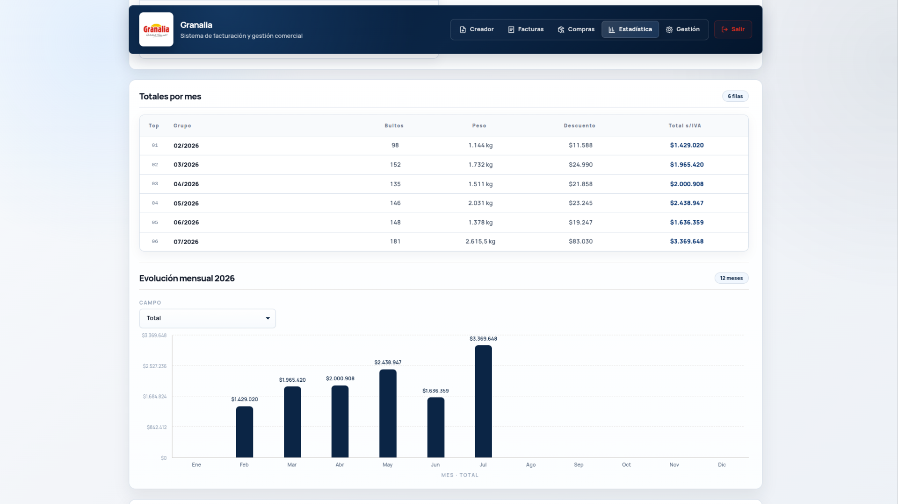

El resumen estadístico muestra métricas agregadas para entender volumen de ventas, comportamiento del período y resultados generales. La intención fue convertir datos transaccionales en información rápida para decisión comercial.

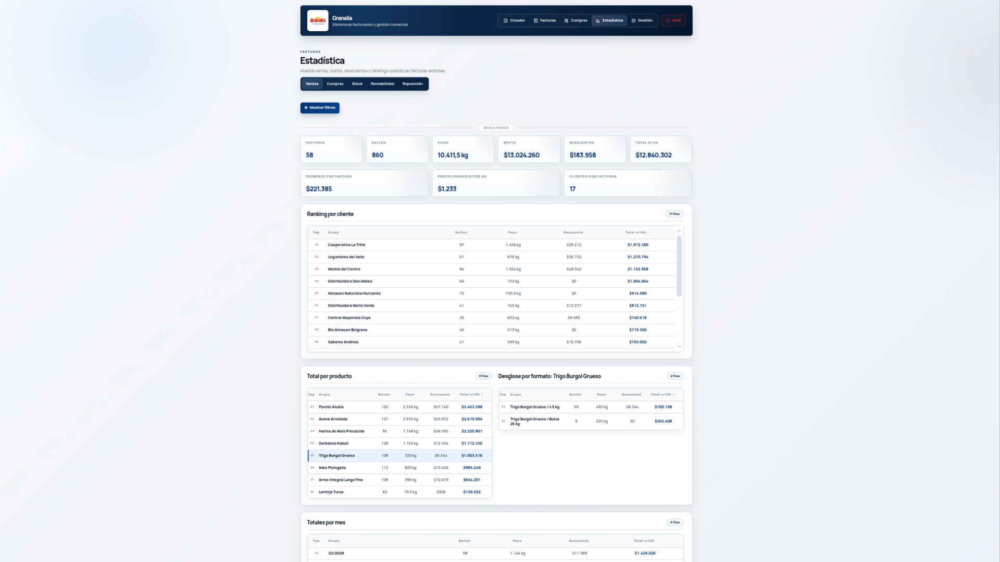

Los rankings ayudan a identificar productos, clientes o categorías con mayor peso dentro de la operación. Este caso de uso permite detectar tendencias sin exportar datos manualmente a una planilla.

### Compras, proveedores y stock

El sistema sumó un módulo de compras para registrar ingreso de materia prima por proveedor, producto, kilos, costo por kilo, comprobante del proveedor, estado de pago y observaciones. Cada compra puede editarse, consultarse desde un historial con filtros y vincularse a un proveedor existente o a un proveedor cargado en el momento.

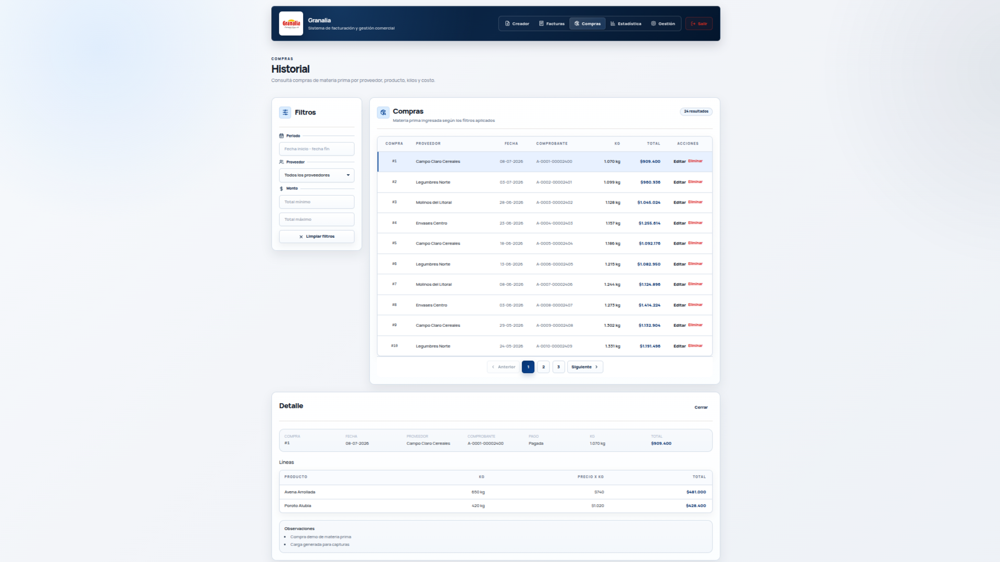

Este módulo comparte productos con facturación, por lo que permite conectar ventas, compras y stock sin duplicar catálogos. Además se incorporaron conteos de stock por producto, con carga individual o por lote, para dejar registrado el inventario físico y compararlo contra el movimiento comercial.

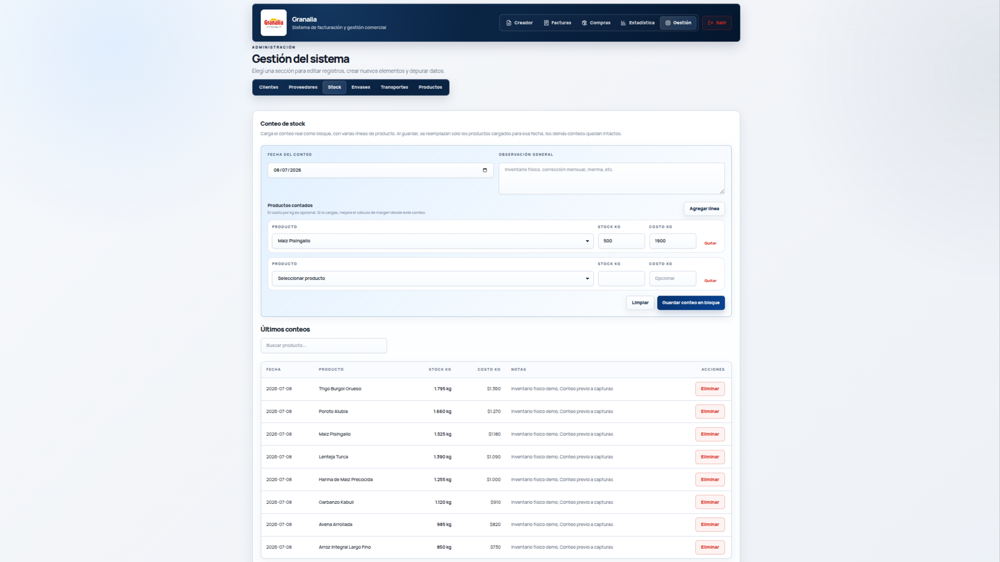

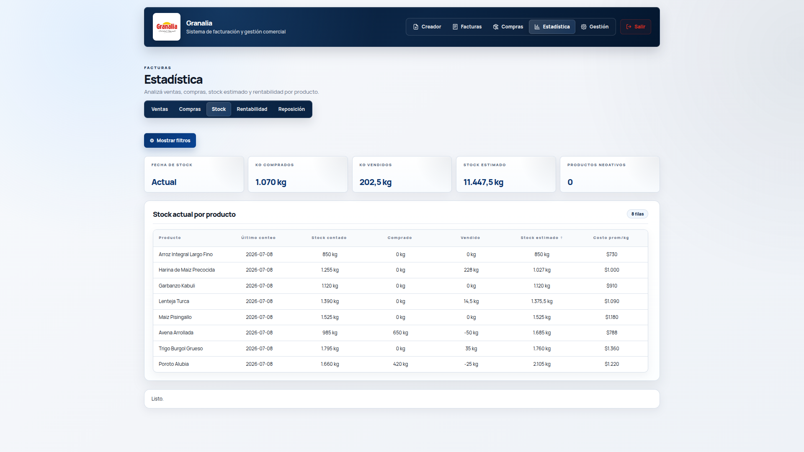

### Costos de reposición y envases

Las estadísticas dejaron de mostrar solo ventas y rankings. También calculan costo de reposición por producto: kilos vendidos, precio promedio de venta, costo actual por kilo, costo necesario para reponer lo vendido, margen contra reposición y porcentaje de margen.

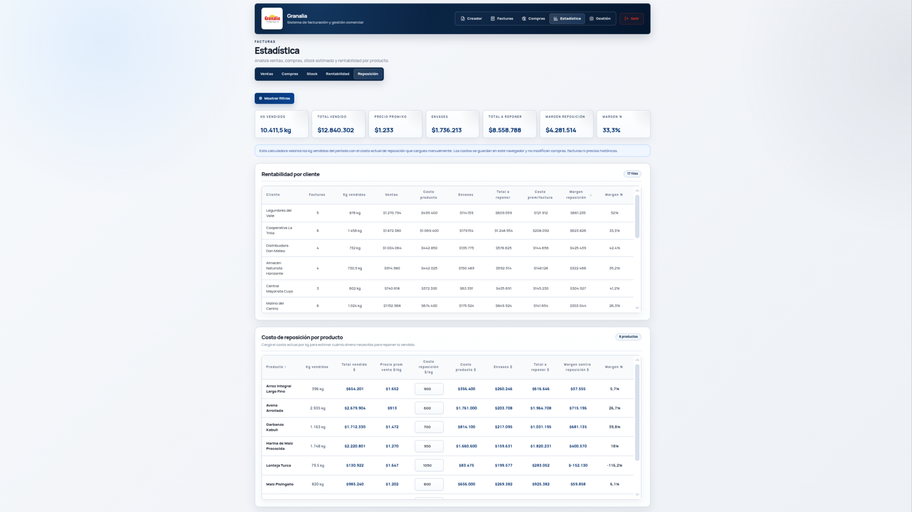

Para que el cálculo sea más realista, se agregó administración de materiales de envase. Cada material puede tener precio por kilo o por unidad, y luego se asigna a formatos específicos, por ejemplo una regla genérica para todos los productos de un formato o una regla puntual para un producto. Con esa información, el sistema suma costo de producto y costo de envase dentro del análisis de rentabilidad.

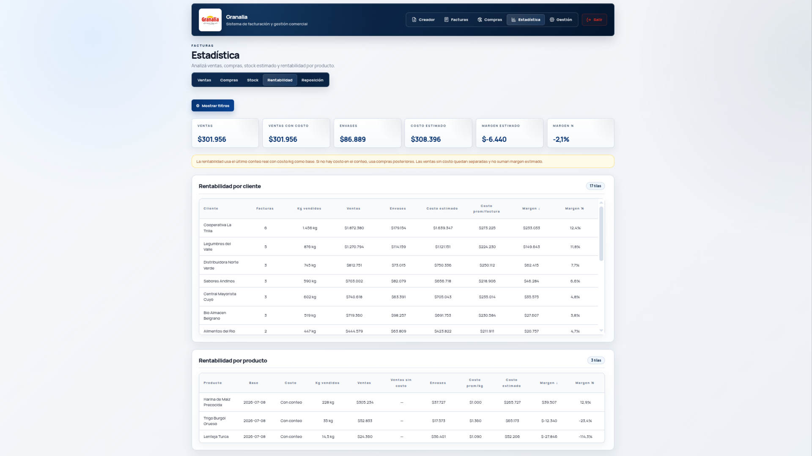

### Presencia comercial en Argentina

El módulo estadístico también incluye un mapa interactivo de presencia comercial. El backend geocodifica clientes con caché en PostgreSQL y el frontend usa MapLibre para visualizar puntos de venta sobre Argentina, agrupando clientes por coordenadas y permitiendo analizar ventas, bultos, kilos o cantidad de facturas por ubicación.

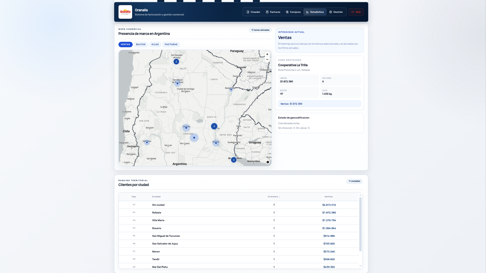

La decisión técnica fue no recalcular geocodificación en cada visita. Se guarda estado, dirección usada, coordenadas y fecha de geocodificación, de modo que el mapa pueda crecer con la base de clientes sin convertir la estadística en una operación lenta o frágil.

## Integración con ARCA

La parte fiscal fue el mayor desafío técnico. El sistema implementa emisión de Factura A mediante WSFEv1, solicitando CAE a ARCA en producción.

Servicios utilizados:

- WSAA para autenticación con certificado, clave privada, ticket de acceso, token y sign.
- WSFEv1 para consultar puntos de venta, último comprobante, comprobantes existentes y solicitar CAE.
- Consulta de datos fiscales por CUIT para precargar información del contribuyente cuando el servicio está disponible y configurado.

El backend genera el login ticket request, firma la solicitud con certificado y clave privada, obtiene un ticket de acceso desde WSAA y luego usa `token` y `sign` para consumir WSFEv1. Esa separación mantiene aislado el flujo de autenticación fiscal respecto de la emisión del comprobante.

El flujo fiscal no autoriza automáticamente al guardar. Primero se crea una factura fiscal en borrador y luego un administrador ejecuta la acción sensible `Autorizar en ARCA`, protegida con contraseña adicional. Si ARCA responde correctamente, se persisten CAE, vencimiento de CAE, numeración fiscal, resultado y observaciones.

Las facturas fiscales autorizadas quedan bloqueadas. Esta decisión evita que un documento con validez fiscal pueda modificarse luego de haber recibido CAE.

La integración también contempla notas de crédito fiscales. Cuando una factura autorizada necesita corregirse, la operación no modifica la factura original: crea un documento nuevo asociado, con contraseña fiscal, importes y alícuotas controladas. Esto respeta la trazabilidad del comprobante autorizado y evita editar documentos con efecto legal.

## Manejo de errores fiscales

Una integración fiscal productiva no puede tratar todos los errores igual. El backend diferencia estados como ARCA deshabilitado, ARCA no configurado, rechazo fiscal, error técnico, timeout, error de red y conflicto de autorización.

La clasificación operativa distingue cuatro escenarios principales:

- Error de validación local: el sistema detecta datos incompletos o inconsistentes y no envía la solicitud a ARCA.
- Rechazo fiscal: ARCA responde, pero no autoriza el comprobante.
- Error técnico: no hay certeza de si ARCA llegó a procesar la solicitud, por ejemplo ante timeout o error de red.
- Autorización exitosa: ARCA devuelve CAE, vencimiento y número fiscal.

Ante errores técnicos o timeouts, el sistema consulta el último comprobante autorizado y, si corresponde, consulta el comprobante específico. Esto permite recuperar un CAE ya generado y evita reintentos inseguros que podrían duplicar comprobantes o romper la numeración fiscal.

También se auditan requests y responses en una tabla dedicada, pero con payloads sanitizados para no persistir secretos como token/sign ni claves privadas.

## Datos e integridad

La base usa PostgreSQL 16 con claves foráneas, constraints, índices únicos y JSONB para estructuras flexibles como descuentos, notas, reglas comerciales y snapshots.

El modelo de datos separa usuarios, clientes, proveedores, productos, listas de precios, compras, stock, costos de reposición, costos de envases, remitos, comprobantes fiscales, ítems, secuencias de numeración, notas de crédito y auditoría de requests fiscales.

Las decisiones de integridad más importantes fueron separar numeración de remitos y numeración fiscal, guardar snapshots históricos y representar estados explícitos para facturas fiscales: `draft`, `authorizing`, `authorized`, `rejected` y `error`.

Sobre esa base se agregaron protecciones para casos que suelen aparecer en operación real: CUIT único en clientes y proveedores, nombres de producto únicos, validación de catálogos activos antes de facturar, timestamps de auditoría en comprobantes y constraints que exigen datos ARCA completos para facturas marcadas como autorizadas. También hay guardas en repositorio para impedir cambios sobre comprobantes fiscalmente bloqueados, no solo desde la interfaz.

Para migraciones e historial fiscal, se incorporaron scripts operativos capaces de importar comprobantes históricos desde PDFs de ARCA, reconstruir ítems, totales, CAE, numeración y request auditado, además de utilidades para reparar numeraciones históricas cuando el origen documental lo requiere.

## Seguridad

El sistema incorpora seguridad a nivel de aplicación y operación:

- Sesiones con cookies HTTP-only, token CSRF y CORS configurable.
- Roles `admin` / `operator` con rutas protegidas en backend y frontend.
- Validaciones con Pydantic y constraints en PostgreSQL.
- Cookies seguras en producción y validación estricta de secretos.
- Contraseña adicional para autorización fiscal.
- Logging sin exposición de secretos.

## Experiencia de uso

La interfaz también fue ajustada para operación móvil: menú responsive, tablas con versión de tarjetas en pantallas chicas, acciones táctiles más claras y descargas de PDF accesibles desde historial y detalle. La intención fue que el sistema no dependa de una pantalla de escritorio para tareas operativas simples.

## Infraestructura

El despliegue está preparado con Docker Compose, Caddy y PostgreSQL containerizado. Caddy sirve el frontend estático y actúa como reverse proxy hacia FastAPI. El backend expone health checks de vida y disponibilidad, logging estructurado y tiempos de respuesta por request mediante `X-Response-Time-Ms`.

## Resultado

Granalia es un caso de sistema full-stack con dominio real, reglas comerciales complejas, integración fiscal productiva y necesidades operativas concretas. El valor técnico estuvo en convertir un flujo manual en una aplicación mantenible, auditable y preparada para producción.

El aprendizaje principal fue diseñar software alrededor de invariantes de negocio: un documento histórico no debe cambiar, una factura fiscal autorizada no debe editarse, un timeout no debe duplicar numeración y una operación sensible debe ser explícita.
